# 🌬️ Urban Air Quality Assistant

> A GenAI-powered assistant that helps families and communities navigate severe winter smog. Enter today's air reading (or look up a town), describe your household, and receive a data-driven daily plan of low-emission routines, indoor air hacks, and sustainable swaps — each with a plain-language explanation and an estimated percentage reduction in PM2.5 exposure.

**Design Principle:** _Numbers come from code, words come from the model._ A small, fully tested rules engine decides what to recommend and computes every impact figure. The Claude model only rewrites that plan in plain language (nine languages) and answers follow-up questions from it, so it **cannot invent advice or numbers**. With no API key the app still works fully, using deterministic text.

> [!IMPORTANT]
> **Not medical advice.** The app says so explicitly and tells people when to seek professional care.

---

## 📑 Table of Contents

- [What It Does](#-what-it-does)
- [Architecture Overview](#-architecture-overview)
- [Project Structure](#-project-structure)
- [Data Flow](#-data-flow)
- [Exposure Model](#-exposure-model)
- [API Reference](#-api-reference)
- [Getting Started](#-getting-started)
- [Deployment on Render](#-deployment-on-render)
- [Quality Criteria](#-quality-criteria)
  - [Problem Statement Alignment](#1-problem-statement-alignment-high-impact)
  - [Code Quality](#2-code-quality-high-impact)
  - [Security](#3-security)
  - [Efficiency](#4-efficiency)
  - [Testing](#5-testing)
  - [Accessibility](#6-accessibility)
- [Assumptions & Limitations](#-assumptions--limitations)
- [License](#-license)

---

## 🎯 What It Does

| Need | Where It Lives |
|---|---|
| **Tailored to location** | Live PM2.5 by town name via [Open-Meteo](https://open-meteo.com/) (free, no key) or a manually typed PM2.5 / US AQI reading. The plan changes with the air band, from *Good* to *Hazardous*. |
| **Tailored to lifestyle** | Children, older adults, pregnancy, asthma/heart disease, commute mode, cooking fuel, heating source, hours outdoors, purifier ownership. |
| **Low-emission daily routines** | Midday outings (winter inversions trap pollution at dawn and dusk), respirator guidance, indoor exercise, car cabin recirculation. |
| **Indoor air hacks** | Purifier use or a DIY Corsi-Rosenthal box fan, sealing and airing rules, damp cleaning, and gimmicks to skip. |
| **Sustainable alternatives** | Clean cooking and heating, swapping car trips, no open burning, street-level community action. |
| **Direct impact, explained** | Each action has a plain-language "why" and an estimated % cut in daily PM2.5 exposure. A before/after bar shows the combined effect, and "How we estimated this" lists every assumption. |

---

## 🏗️ Architecture Overview

The application follows a clean **three-tier architecture**: a static browser frontend communicates with a lightweight Python HTTP server, which orchestrates a deterministic rules engine and an optional GenAI layer.

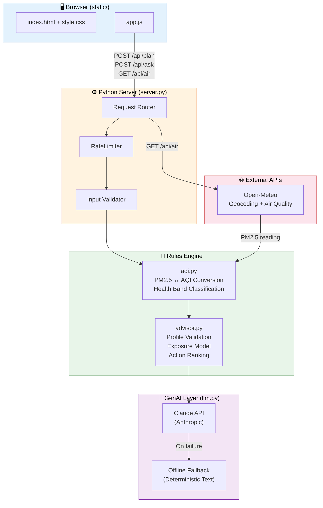

---

## 📂 Project Structure

```
urban-air-assistant/
├── airassist/                  # Python package — the entire backend
│   ├── __init__.py             # Package metadata (version)
│   ├── __main__.py             # Entry point: python -m airassist
│   ├── server.py               # HTTP server, routing, validation, rate limiting, security headers
│   ├── aqi.py                  # PM2.5 ↔ US AQI conversion, health band classification
│   ├── advisor.py              # Rule-based planner, exposure model, profile validation
│   ├── llm.py                  # Claude API wrapper with offline fallback
│   └── airdata.py              # Open-Meteo live PM2.5 lookup with bounded TTL cache
│
├── static/                     # Frontend — served as fixed static assets
│   ├── index.html              # Semantic, accessible HTML form
│   ├── app.js                  # Vanilla JS: form handling, API calls, DOM rendering
│   └── style.css               # Responsive CSS with light/dark themes
│
├── tests/                      # 33 unit tests, no network needed
│   ├── test_engine.py          # AQI maths, planner rules, GenAI layer, live lookup
│   ├── test_api.py             # Black-box HTTP API tests (ephemeral server)
│   └── test_static.py          # Accessibility labels + XSS-safe rendering checks
│
├── render.yaml                 # Render Blueprint for one-click deployment
├── requirements.txt            # Empty (stdlib only) — required by Render's build
├── .python-version             # Pins Python 3.12.8 for Render
├── .gitignore                  # Ignores __pycache__, .venv, .env
└── README.md                   # This file
```

---

## 🔄 Data Flow

### Plan Generation Flow

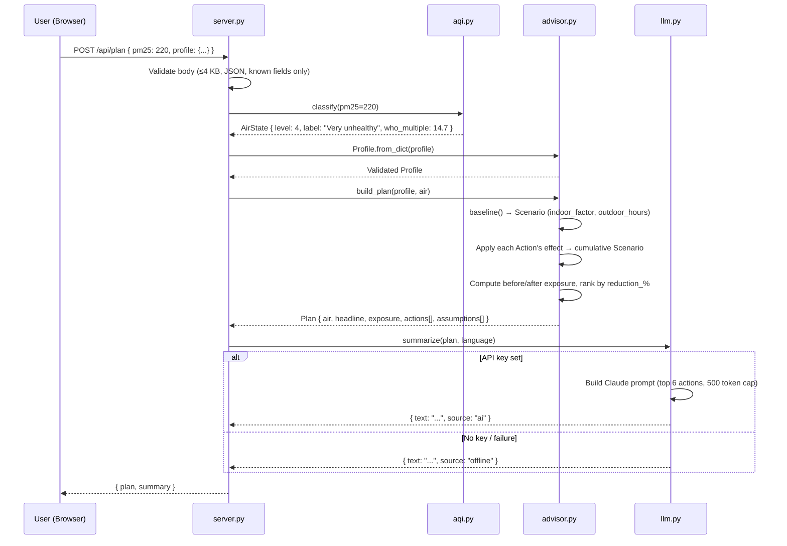

### City Lookup Flow

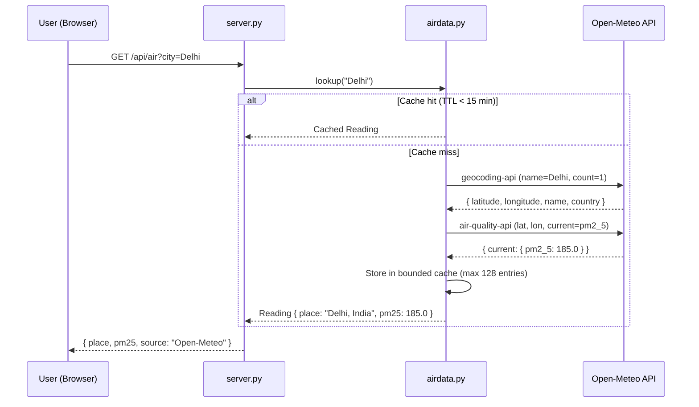

---

## 📊 Exposure Model

The advisor module uses a **24-hour time-weighted exposure model** to quantify each recommendation's impact. All constants are shown transparently to the user.

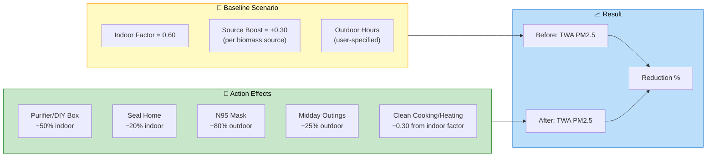

**Exposure formula:**

$$\text{TWA} = \text{PM2.5} \times \frac{(\text{outdoor\_hours} \times \text{outdoor\_scale} \times (1 - \text{mask\_cut})) + ((24 - \text{outdoor\_hours}) \times \text{indoor\_factor})}{24}$$

| Constant | Value | Meaning |
|---|---|---|
| `INDOOR_FACTOR` | 0.60 | Indoor/outdoor PM2.5 ratio in a naturally ventilated home |
| `SOURCE_BOOST` | +0.30 | Added by biomass cooking, and again by biomass/coal heating |
| `PURIFIER_CUT` | 0.50 | Indoor particles removed by a right-sized HEPA or DIY box filter |
| `SEALING_CUT` | 0.20 | Further indoor reduction from shut windows and sealed gaps |
| `MASK_CUT` | 0.80 | Outdoor inhalation removed by a well-fitted N95/FFP2 |
| `MIDDAY_CUT` | 0.25 | Winter midday air is ~25% cleaner than dawn and dusk air |

> [!NOTE]
> Per-step percentages overlap (each applies to its own slice of the day), so they do not add up to the combined figure. The combined reduction is computed by chaining all applicable effects through the `Scenario` dataclass.

---

## 🔌 API Reference

| Endpoint | Method | Body / Query | Response |
|---|---|---|---|
| `/api/plan` | `POST` | `{"pm25": 220}` or `{"aqi": 180}`, plus optional `"profile": {...}` | `{"plan": {...}, "summary": {...}}` |
| `/api/ask` | `POST` | Same as plan, plus `"question"` (≤300 chars) | `{"answer": {"text": "...", "source": "ai\|offline"}}` |
| `/api/air?city=` | `GET` | Town name as query param | `{"place": "...", "pm25": 88.5, "source": "Open-Meteo"}` |
| `/healthz` | `GET` | — | `{"status": "ok", "ai": true\|false}` |

### Profile Fields

| Field | Type | Values | Default |
|---|---|---|---|
| `children` | `boolean` | — | `false` |
| `elderly` | `boolean` | — | `false` |
| `pregnancy` | `boolean` | — | `false` |
| `heart_lung` | `boolean` | — | `false` |
| `has_purifier` | `boolean` | — | `false` |
| `commute` | `string` | `none`, `walk_cycle`, `two_wheeler`, `car`, `public_transport` | `none` |
| `cooking` | `string` | `lpg_png`, `electric`, `biomass` | `lpg_png` |
| `heating` | `string` | `none`, `electric`, `biomass_coal` | `none` |
| `outdoor_hours` | `number` | `0` to `16` | `2.0` |
| `language` | `string` | `en`, `hi`, `bn`, `ta`, `te`, `mr`, `ur`, `es`, `zh` | `en` |

---

## 🚀 Getting Started

### Prerequisites

- **Python 3.10+** — no third-party dependencies required (stdlib only)

### Run Locally

```bash
# Start the server
python -m airassist                          # → http://127.0.0.1:8000

# Run the test suite (33 tests, no network needed)
python -m unittest discover -s tests -v
```

### Environment Variables

| Variable | Default | Purpose |
|---|---|---|
| `ANTHROPIC_API_KEY` | _(unset)_ | Enables AI-written, multilingual summaries and Q&A. Unset = offline text. |
| `AIR_ASSIST_MODEL` | `claude-haiku-5-5` | Claude model used for the explanations. |
| `HOST` | `127.0.0.1` | Bind address. Use `0.0.0.0` only behind a reverse proxy. |
| `PORT` | `8000` | Bind port. |

---

## ☁️ Deployment on Render

The repository includes a [`render.yaml`](render.yaml) Blueprint for one-click deployment.

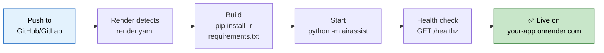

**Steps:**

1. Push this repository to GitHub or GitLab.
2. In Render dashboard → **New +** → **Blueprint** → select your repository.
3. Render reads `render.yaml` and configures the web service automatically.
4. Optionally set `ANTHROPIC_API_KEY` in Render's environment variables to enable AI summaries.

> [!TIP]
> **Manual setup** (if not using Blueprint): set **Build Command** = `pip install -r requirements.txt`, **Start Command** = `python -m airassist`, **Health Check Path** = `/healthz`, and add env var `HOST=0.0.0.0`. Render provides `PORT` automatically.

---

## ✅ Quality Criteria

### 1. Problem Statement Alignment _(High Impact)_

This application directly addresses the core challenge of helping families and communities survive severe winter smog episodes, with every feature mapping back to the brief:

```mermaid
flowchart TD
    PS["🎯 Problem: Families need<br/>actionable smog guidance"]

    PS --> L["📍 Location-aware"]
    PS --> P["👨‍👩‍👧‍👦 Lifestyle-tailored"]
    PS --> A["🏠 Actionable daily plans"]
    PS --> I["📊 Quantified impact"]
    PS --> M["🌍 Multilingual"]

    L --> L1["Live PM2.5 lookup\n(Open-Meteo, no key)"]
    L --> L2["Manual PM2.5 or\nUS AQI input"]
    L --> L3["6 health bands:\nGood → Hazardous"]

    P --> P1["Sensitive groups:\nchildren, elderly,\npregnancy, heart/lung"]
    P --> P2["Commute mode,\ncooking fuel,\nheating source"]
    P --> P3["Hours outdoors,\npurifier ownership"]

    A --> A1["Low-emission routines\n(midday outings, masks)"]
    A --> A2["Indoor air hacks\n(purifier, sealing, cleaning)"]
    A --> A3["Sustainable swaps\n(clean fuel, no burning)"]

    I --> I1["Per-action % reduction"]
    I --> I2["Before/after exposure bar"]
    I --> I3["Transparent assumptions"]

    M --> M1["9 languages: en, hi,\nbn, ta, te, mr,\nur, es, zh"]

    style PS fill:#ffcdd2,stroke:#c62828,color:#000
    style L fill:#e3f2fd,stroke:#1565c0,color:#000
    style P fill:#fff9c4,stroke:#f9a825,color:#000
    style A fill:#c8e6c9,stroke:#388e3c,color:#000
    style I fill:#e1bee7,stroke:#7b1fa2,color:#000
    style M fill:#ffe0b2,stroke:#e65100,color:#000
```

| Aspect | How It's Addressed |
|---|---|
| **Root challenge** | Winter smog specifically: inversion-aware timing, solid-fuel/open-burning sources, children and sensitive groups, medical-help triggers. |
| **User needs** | Non-expert families get a plan in their language, with every step explained in words a 12-year-old can follow. |
| **Core objectives** | Reduce exposure (quantified), change behaviour (routines), and empower communities (sustainable swaps). |

---

### 2. Code Quality _(High Impact)_

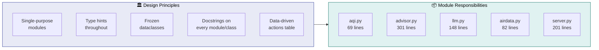

**Key design decisions:**

- **Single-responsibility modules** — each file has exactly one job and is under 301 lines. `aqi.py` does maths. `advisor.py` does rules. `llm.py` talks to Claude. `airdata.py` fetches readings. `server.py` handles HTTP.
- **Frozen dataclasses** — `AirState`, `Profile`, `Scenario`, `Action`, and `Reading` are all immutable. This eliminates accidental mutation bugs and makes the data flow explicit.
- **Data-driven action table** — the `ACTIONS` tuple in `advisor.py` is a declarative table. Adding a new recommendation is one entry plus one test. Each action specifies its `id`, `category`, `title`, `why`, `applies` predicate, and optional `effect` function.
- **Type hints** — every function signature uses type annotations, including generics like `Callable[[Scenario], Scenario]` and `Mapping[str, object]`.
- **Docstrings** — every module, class and public function has a docstring explaining its purpose.
- **Zero dependencies** — the entire application runs on the Python standard library alone.

---

### 3. Security

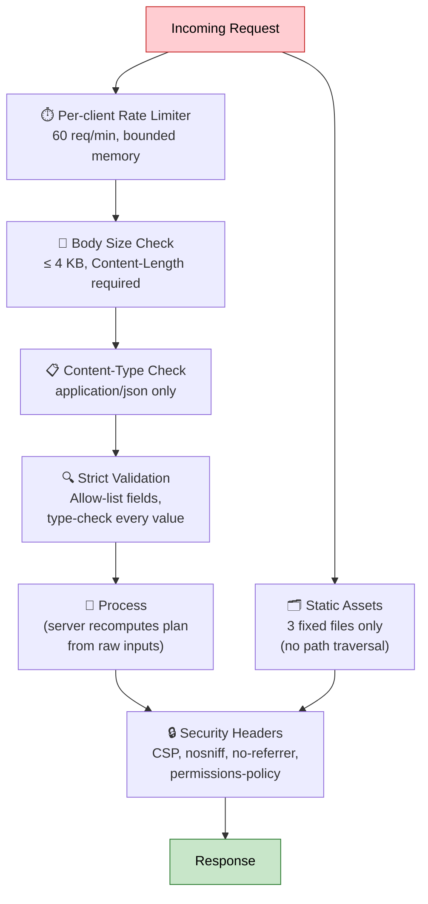

| Layer | What Was Done |
|---|---|
| **Input validation** | Strict allow-list: unknown JSON keys, wrong types, and out-of-range values are rejected with `400`. Profile fields are validated against frozen choice tuples. |
| **Body limits** | 4 KB max body; `Content-Length` required; oversized requests drained (up to 64 KB) and rejected with `413`. |
| **Content-type** | POST endpoints require `application/json`; anything else gets `415`. |
| **Rate limiting** | Fixed-window, per-client, thread-safe with bounded memory (max 4096 clients). Expired windows are pruned on overflow. |
| **Static file serving** | Only three files are ever served (`index.html`, `app.js`, `style.css`) from a preloaded dict. No user-controlled paths reach the filesystem. Path traversal attempts (`/../`, `%2e%2e`) return `404`. |
| **HTTP headers** | `Content-Security-Policy: default-src 'self'`, `X-Content-Type-Options: nosniff`, `Referrer-Policy: no-referrer`, `Permissions-Policy: geolocation=(), camera=(), microphone=()`. |
| **API key safety** | Read from environment variable, sent only in an HTTP header (`x-api-key`), never serialised into the request body. |
| **Network safety** | Only two fixed HTTPS hosts are ever contacted (`geocoding-api.open-meteo.com`, `air-quality-api.open-meteo.com`). No SSRF possible. Response size capped at 64 KB (airdata) and 256 KB (LLM). |
| **Prompt injection hardening** | The server always recomputes the plan from raw validated inputs — the client cannot supply plan text. User questions are stripped of `<>`, length-limited to 300 chars, and wrapped in `<question>` tags that the system prompt declares untrusted data. |
| **XSS prevention** | The frontend uses `document.createElement()` and `textContent` exclusively. `innerHTML`, `outerHTML`, `insertAdjacentHTML`, `document.write`, and `eval()` are banned (tested). No inline scripts or remote assets in the HTML. |
| **Error safety** | All unhandled exceptions are caught and return `{"error": "Internal error."}` with `500`. No tracebacks, no internal state leaked. Log entries omit query strings (which may contain place names). |
| **Socket timeouts** | 10 s client timeout on the HTTP handler; 8 s on Open-Meteo requests; 12 s on Claude API calls. |

---

### 4. Efficiency

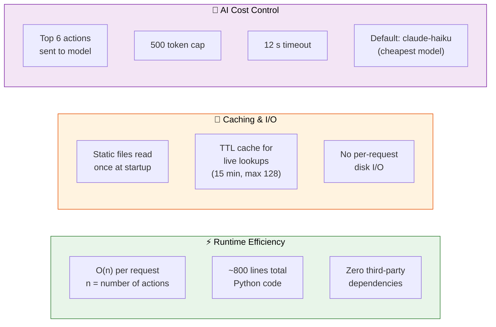

| Aspect | Detail |
|---|---|
| **Algorithmic complexity** | Each request iterates the `ACTIONS` tuple once: O(number of actions), currently 17 entries. |
| **Standard library only** | Zero `pip install` overhead. No dependency vulnerabilities to track. Import time is negligible. |
| **Static files** | Read once at startup into a dict. Subsequent requests serve from memory with `public, max-age=300` caching headers. |
| **Live lookup cache** | Bounded LRU-style TTL cache (15 min, max 128 entries) with thread-safe access. The oldest entry is evicted on overflow. |
| **Rate limiter memory** | Bounded to 4096 clients. Expired windows are garbage-collected on table overflow. |
| **AI prompt size** | Only the top 6 actions (title, why, reduction%) and headline/exposure are sent — not the full plan. 500-token max response. 12 s timeout. Default model is `claude-haiku-5-5` (smallest and cheapest). |
| **Threading** | `ThreadingHTTPServer` handles concurrent requests without a heavyweight async framework. |

---

### 5. Testing

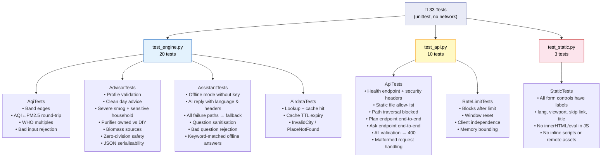

| Quality | Detail |
|---|---|
| **Coverage breadth** | AQI maths, planner rules, validation, GenAI layer (transport injected, every failure path falls back), live lookup and cache, HTTP API end-to-end, rate limiting, accessibility labels, and XSS-safe rendering. |
| **No network** | All external dependencies are injected: `FakeTransport` for Claude, injectable `fetch` and `now` for airdata. The API tests spin up a real server on an ephemeral port (`port 0`). |
| **Deterministic** | All tests run without API keys, network access or timing dependencies. Clock functions are injectable. |
| **Fast** | 33 tests complete in under 2 seconds. |
| **CI ready** | Designed for `python -m unittest discover -s tests -v`. Compatible with Python 3.10 through 3.14. |

```bash
# Run the full suite
python -m unittest discover -s tests -v      # 33 tests, ~1.5s

# Or with pytest
python -m pytest -q                           # same 33 tests
```

---

### 6. Accessibility

```mermaid
flowchart TD
    A11Y["♿ Accessibility"]

    A11Y --> SEM["Semantic HTML"]
    A11Y --> VIS["Visual Design"]
    A11Y --> UX["User Experience"]
    A11Y --> PERF["Performance & Reach"]

    SEM --> SEM1["Landmarks: header,\nmain, footer, section"]
    SEM --> SEM2["Single heading\nhierarchy: h1→h2→h3→h4"]
    SEM --> SEM3["Every control labelled\n(tested in test_static.py)"]
    SEM --> SEM4["Skip link to\nmain form"]

    VIS --> VIS1["Light & dark themes\n(prefers-color-scheme)"]
    VIS --> VIS2["Visible focus ring\n(3px solid outline)"]
    VIS --> VIS3["Colour is never\nthe only signal\n(band name + gauge)"]
    VIS --> VIS4["44px minimum\ntouch targets"]

    UX --> UX1["Focus moves to\nresults after submit"]
    UX --> UX2["role='status' and\nrole='alert' for\nstatus + errors"]
    UX --> UX3["Plain-language copy\na 12-year-old can follow"]
    UX --> UX4["AI explanations\nin 9 languages"]

    PERF --> PERF1["System fonts only\nno external requests"]
    PERF --> PERF2["Works on slow or\noffline networks"]
    PERF --> PERF3["No animation"]
    PERF --> PERF4["noscript fallback\nmessage"]

    style A11Y fill:#e8eaf6,stroke:#283593,color:#000
    style SEM fill:#e3f2fd,stroke:#1565c0,color:#000
    style VIS fill:#fff9c4,stroke:#f9a825,color:#000
    style UX fill:#c8e6c9,stroke:#388e3c,color:#000
    style PERF fill:#ffe0b2,stroke:#e65100,color:#000
```

| Feature | Implementation |
|---|---|
| **Landmarks** | `<header>`, `<main>`, `<footer>`, `<section>` with `aria-label` on the results region. |
| **Heading hierarchy** | Single `h1` → `h2` (results title) → `h3` (sections) → `h4` (action cards). No skipped levels. |
| **Labelled controls** | Every `<input>` and `<select>` has an associated `<label>` (by `for=` or by wrapping). Verified by `test_static.py`. |
| **Skip link** | "Skip to the form" link, visually hidden until focused. |
| **Focus management** | After submitting, focus moves to `#results-title` (the h2) so screen reader users land on the plan. |
| **Status announcements** | Lookup status uses `role="status"` (polite); form errors use `role="alert"` (assertive). The follow-up answer uses `aria-live="polite"`. |
| **Colour independence** | Air quality is communicated via band name text *and* gauge position, not colour alone. |
| **Touch targets** | All buttons, checkboxes and inputs have a minimum height of `2.75rem` (~44px). |
| **Themes** | CSS respects `prefers-color-scheme` with carefully chosen contrast-safe palettes for both light and dark modes. |
| **Performance** | System fonts (`system-ui`), no external CSS/JS/fonts, no animations. Works fully offline (once loaded) if the user types a reading manually. |
| **Multilingual** | AI explanations available in English, Hindi, Bengali, Tamil, Telugu, Marathi, Urdu, Spanish and Chinese. Language options use the `lang` attribute for correct font rendering. |

---

## ⚠️ Assumptions & Limitations

| Assumption | Detail |
|---|---|
| **Not medical advice** | The app says so, and tells people when to seek care. |
| **Illustrative exposure model** | Constants sit at the top of `advisor.py` and are listed in the UI. Replace with local measurements where available. |
| **Live data is modelled** | Open-Meteo's PM2.5 is a model estimate, not a ground monitor reading. Typing a reading from a local monitor is always possible. |
| **US EPA 2024 bands** | AQI bands follow the US EPA PM2.5 breakpoint table in `aqi.BANDS`. Other national scales can be added by editing that table. |
| **Generic to winter smog** | Advice targets winter inversion patterns. Local hours, helplines and municipal rules are the natural next step. |

---

## 📄 License

This project is provided as-is for educational and humanitarian purposes.
